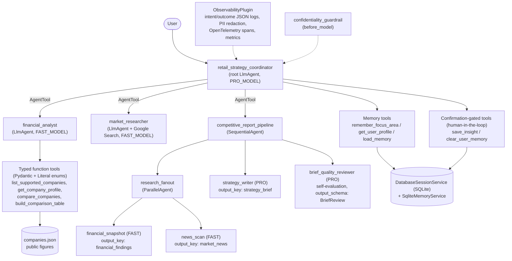

# 🛒 Retail Competitive Intelligence Agent

A multi-agent system built with the **Google Agent Development Kit (ADK)** that helps a
strategy team compare **Walmart** with its top five US retail competitors:
**Amazon, Costco, Target, Kroger and The Home Depot**. It uses **public data only**.

> **Track:** Enterprise Agents

---

## 1. The problem

Before account strategy planning, teams spend hours collecting competitor financials,
reading earnings news and building SWOT slides by hand. The information is scattered across
10-Ks, press releases and news sites, and it goes stale quickly.

## 2. The solution

You ask a question in plain English, for example:

> *"Compare Walmart vs. Costco and Target on membership and e-commerce, and give me talking points."*

A team of specialist agents then:

1. pulls **structured financials** from a curated public dataset, using tools that rank,
   compare and calculate ratios,
2. **searches the web** for the latest strategic moves,
3. writes an **executive brief** with a scorecard, a competitor-by-competitor view, a SWOT
   and talking points,
4. **checks its own work**: a reviewer agent confirms every number comes from the data,
   all sections are there and the disclaimer is included, and fixes the brief if not,
5. **remembers** your focus areas (for example *retail media* or *grocery*) and saved
   insights across sessions, and asks for your approval before saving or deleting them.

---

## 3. Architecture



**How a full brief flows:** the coordinator calls the pipeline → the financial and news
agents run **in parallel** and write their results to session state → the writer drafts the
brief from that state → the reviewer audits the draft against `financial_findings` and returns
a validated `BriefReview` (`verdict`, `checks`, `issues_found`, `final_brief`) → the
coordinator presents `final_brief`.

---

## 4. Rubric map

Every criterion below is implemented in code and covered by tests in [`tests/`](tests/).

| # | Area | Criterion | How it is implemented | Where |
|---|---|---|---|---|
| 1 | Tool & Interface Design | **Tool docstrings** | Every tool has a Google-style docstring (purpose, when to call, `Args`, `Returns`); ADK sends it to Gemini as the tool description. | [`retail_tools.py`](retail_intel_agent/tools/retail_tools.py) |
| 2 | | **Descriptive naming** | Verb-first tool names (`compare_companies`, `build_comparison_table`, `clear_user_memory`), explicit state keys (`user:focus_areas`), named agents (`brief_quality_reviewer`). | [`retail_tools.py`](retail_intel_agent/tools/retail_tools.py), [`agent.py`](retail_intel_agent/agent.py) |
| 3 | | **Explicit JSON schemas** | `Metric` / `CompanyKey` are `typing.Literal` enums, so the FunctionDeclaration has an `enum`. Inputs are validated with Pydantic input models; every result is a Pydantic output model validated before `model_dump()`. The reviewer uses `output_schema=BriefReview`. | [`schemas.py`](retail_intel_agent/tools/schemas.py), [`test_tools.py`](tests/test_tools.py) |
| 4 | | **Guided error handling** | Tools never raise; errors use one `ToolError` shape with `error_message`, an explicit `recovery` instruction and `valid_options`. Unexpected exceptions are caught by the plugin and returned with recovery steps. | [`retail_tools.py`](retail_intel_agent/tools/retail_tools.py), [`observability.py`](retail_intel_agent/observability.py) |
| 5 | Context & Memory | **Robust system instructions** | The coordinator prompt is a "constitution": identity & mission, domain knowledge, user memory, operating procedure, hard constraints, error handling, output contract. | [`prompts.py`](retail_intel_agent/prompts.py) |
| 6 | | **History compaction** | `EventsCompactionConfig` summarizes older turns every `COMPACTION_INTERVAL` messages. | [`agent.py`](retail_intel_agent/agent.py), [`config.py`](retail_intel_agent/config.py) |
| 7 | | **Persistent session state** | `DatabaseSessionService` on SQLite (`sqlite+aiosqlite:///.adk/sessions.db`) + `SqliteMemoryService`. Used by `make web`, the Dockerfile and [`run_cli.py`](run_cli.py). `user:` state survives restarts (tested). | [`persistence.py`](retail_intel_agent/persistence.py), [`Makefile`](Makefile), [`test_persistence.py`](tests/test_persistence.py) |
| 8 | | **Async memory operations** | `after_agent_callback` schedules `add_session_to_memory()` with `asyncio.create_task`, keeps a strong reference in `_BACKGROUND_TASKS` and logs failures, so the response is never blocked. | [`agent.py`](retail_intel_agent/agent.py) (`save_session_to_memory`) |
| 9 | Orchestration & Logic | **Multi-agent patterns** | Coordinator + specialists as `AgentTool`s, a `SequentialAgent` pipeline wrapping a `ParallelAgent` fan-out, state hand-off via `output_key`. | [`agent.py`](retail_intel_agent/agent.py) |
| 10 | | **Strategic model routing** | `PRO_MODEL` for the coordinator, writer and reviewer (reasoning); `FAST_MODEL` for data and search specialists. Both are env-overridable. | [`config.py`](retail_intel_agent/config.py), [`test_config.py`](tests/test_config.py) |
| 11 | | **Guardrails & self-evaluation** | `confidentiality_guardrail` (before_model) blocks confidential input. `brief_quality_reviewer` checks grounding, sections and disclaimer, and outputs a corrected brief. | [`agent.py`](retail_intel_agent/agent.py), [`prompts.py`](retail_intel_agent/prompts.py) |
| 12 | | **Human-in-the-loop** | `save_insight` and `clear_user_memory` are wrapped in `FunctionTool(..., require_confirmation=True)`. ADK pauses for approval (`adk web` shows Approve/Reject; `run_cli.py` prompts y/N). | [`agent.py`](retail_intel_agent/agent.py), [`run_cli.py`](run_cli.py), [`test_agent.py`](tests/test_agent.py) |
| 13 | Observability | **Structured JSON logging** | One JSON object per line, ready for Cloud Logging; `LOG_LEVEL` env var. | [`observability.py`](retail_intel_agent/observability.py) |
| 14 | | **Intent vs. outcome capture** | Each run, agent, model call and tool call logs an `intent` (goal, args, tools offered) and an `outcome` (status, decision, result preview, latency, tokens). Both share a `correlation_id`. | [`observability.py`](retail_intel_agent/observability.py) |
| 15 | | **Distributed tracing** | ADK's OpenTelemetry spans, plus a custom `retail_intel.tool/<name>` span around every tool with attributes. `trace_id`/`span_id` are stamped on every log line. Cloud Trace export turns on with `ENABLE_CLOUD_TRACE=true`. | [`telemetry.py`](retail_intel_agent/telemetry.py) |
| 16 | | **PII redaction** | Regex redaction of emails, phones, SSNs, card numbers and API keys, applied to every log payload and to everything written to state or memory. It can be replaced by Cloud DLP without changing callers. | [`pii.py`](retail_intel_agent/pii.py), [`test_pii.py`](tests/test_pii.py) |
| 17 | Infrastructure & CI/CD | **Automated evaluation suite** | ADK golden eval set (6 cases: tool trajectory + reference answers), built with ADK's `EvalSet` models; `test_config.json` thresholds; `AgentEvaluator` test; offline golden tool-output test; `make eval`. | [`eval/`](eval/), [`test_eval.py`](tests/test_eval.py) |
| 18 | | **Infrastructure as Code** | Terraform: APIs, Artifact Registry, least-privilege service account, Secret Manager secret, Cloud Run v2 service with the secret as an env var. | [`terraform/`](terraform/) |
| 19 | | **Secure secret management** | No hardcoded keys. `GOOGLE_API_KEY` comes from the env, or from Secret Manager via `GOOGLE_API_KEY_SECRET` (lazy import). CI runs **gitleaks** on full history; `.env` is git-ignored. | [`config.py`](retail_intel_agent/config.py), [`ci.yml`](.github/workflows/ci.yml) |

CI ([`ci.yml`](.github/workflows/ci.yml)) runs: gitleaks secret scan → ruff + pytest on Python
3.11/3.12 + eval-set drift check → optional live `adk eval` (when a `GOOGLE_API_KEY` secret exists)
→ `terraform fmt -check` + `terraform validate` → Docker build.

---

## 5. Quick start

```bash
# 1. Install
git clone https://github.com/<your-username>/retail-competitive-intel-agent.git
cd retail-competitive-intel-agent
make install            # creates .venv and installs dependencies

# 2. Add your Gemini API key (free: https://aistudio.google.com/apikey)
cp .env.example retail_intel_agent/.env
# edit retail_intel_agent/.env and paste your key

# 3. Chat with the agent in your browser at http://localhost:8000
make web                # sessions + memory persist in .adk/
```

Prefer the terminal? `make cli` starts [`run_cli.py`](run_cli.py) with persistent sessions
and y/N approval prompts (resume with `python run_cli.py --session <id>`).

### Try these prompts
- `Which companies can you analyze?`
- `Rank all six retailers by operating margin.`
- `I care most about retail media and grocery.` *(saved to memory)*
- `Give me a full competitive brief on Walmart vs. Amazon and Costco.`
- `What has Target announced recently about its loyalty program?`
- `Save this insight: Costco's renewal rate is the loyalty benchmark.` *(asks for approval)*
- `What do you remember about me?`
- `Forget everything you know about me.` *(asks for approval)*

### Model routing
| Setting | Default | Used by |
|---|---|---|
| `PRO_MODEL` | `gemini-3.5-flash` | coordinator, strategy writer, brief reviewer |
| `FAST_MODEL` | `gemini-3.5-flash-lite` | financial analyst, market researcher, pipeline research steps |

The defaults work with a free-tier key. With a paid key, set `PRO_MODEL=gemini-3.1-pro-preview`
for deeper reasoning.

---

## 6. Testing and evaluation

```bash
make test       # offline: tools, schemas, guardrail, HITL, PII, persistence, tracing, eval format
make lint
```

**Golden evaluation set** ([`eval/data/retail_intel.evalset.json`](eval/data/retail_intel.evalset.json)):
six cases covering routing to the right specialist, memory writes and reads, and the
confidentiality guardrail. Each case has an expected tool trajectory and a reference answer.
Thresholds are in [`test_config.json`](eval/data/test_config.json) (`tool_trajectory_avg_score`
≥ 0.8 with in-order matching, `response_match_score` ≥ 0.3).

```bash
make install-eval   # ADK eval extras
make eval           # adk eval against the live agent (needs GOOGLE_API_KEY)
make evalset        # regenerate the JSON after editing eval/build_evalset.py
```

[`eval/data/golden_tool_outputs.json`](eval/data/golden_tool_outputs.json) holds expected tool
results (rankings, margins, guided errors). They are checked offline on every CI run.

---

## 7. Observability

- **Logs:** every step prints an `intent` line and a matching `outcome` line, for example
  `{"message": "outcome:tool", "event": "outcome", "tool": "compare_companies", "status": "success", "latency_ms": 2, "correlation_id": "...", "trace_id": "..."}`.
  Each run ends with an `outcome:run` summary of model calls, tool calls, tokens and latency.
  PII is redacted before anything is written.
- **Traces:** open the **Trace** tab in `adk web` to see the span tree, including the custom
  `retail_intel.tool/*` spans.
- **Cloud:** set `ENABLE_CLOUD_TRACE=true` (Terraform does this) or use `make deploy`
  (`--trace_to_cloud`) to export spans to Cloud Trace. Log lines include
  `logging.googleapis.com/trace`, so Cloud Logging links each entry to its trace.

---

## 8. Deploy

**Option A – Terraform (recommended, least privilege):** see [`terraform/README.md`](terraform/README.md).

```bash
cd terraform && cp terraform.tfvars.example terraform.tfvars   # set project_id
terraform init && terraform apply
```

**Option B – one command:** `export GOOGLE_CLOUD_PROJECT=your-project-id && make deploy`
(wraps `adk deploy cloud_run --trace_to_cloud`).

For a production template with CI/CD and Agent Engine support, see the
[Agent Starter Pack](https://github.com/GoogleCloudPlatform/agent-starter-pack).

---

## 9. Project structure

```
retail-competitive-intel-agent/
├── retail_intel_agent/
│   ├── agent.py            # root agent, specialists, pipeline, reviewer, callbacks, App
│   ├── prompts.py          # coordinator constitution + specialist instructions
│   ├── config.py           # model routing, persistence, Secret Manager key loading
│   ├── persistence.py      # DatabaseSessionService + SqliteMemoryService factories
│   ├── observability.py    # intent/outcome JSON logs, metrics, tool spans, error handling
│   ├── telemetry.py        # OpenTelemetry tracer, trace-id log linking, Cloud Trace export
│   ├── pii.py              # PII redaction for logs, state and memory
│   ├── tools/retail_tools.py
│   ├── tools/schemas.py    # Pydantic input/output models + Literal enums
│   └── data/companies.json # curated public figures
├── run_cli.py              # persistent terminal runner with approval prompts
├── eval/                   # golden eval set, config, golden tool outputs, builder
├── tests/                  # pytest suite (offline) + live tests (with GOOGLE_API_KEY)
├── terraform/              # IaC for Cloud Run, Secret Manager, IAM, Artifact Registry
├── deployment/deploy_cloud_run.sh
├── .github/workflows/ci.yml
├── Dockerfile, Makefile, pyproject.toml, requirements*.txt, .env.example
```

## 10. Data disclaimer

The figures in `companies.json` are **approximate, rounded values from public annual
reports**, included for illustration. Check them against the latest filings before making
decisions. The agent works with public information only. It declines content marked as
confidential and redacts personal data before logging or saving it.
