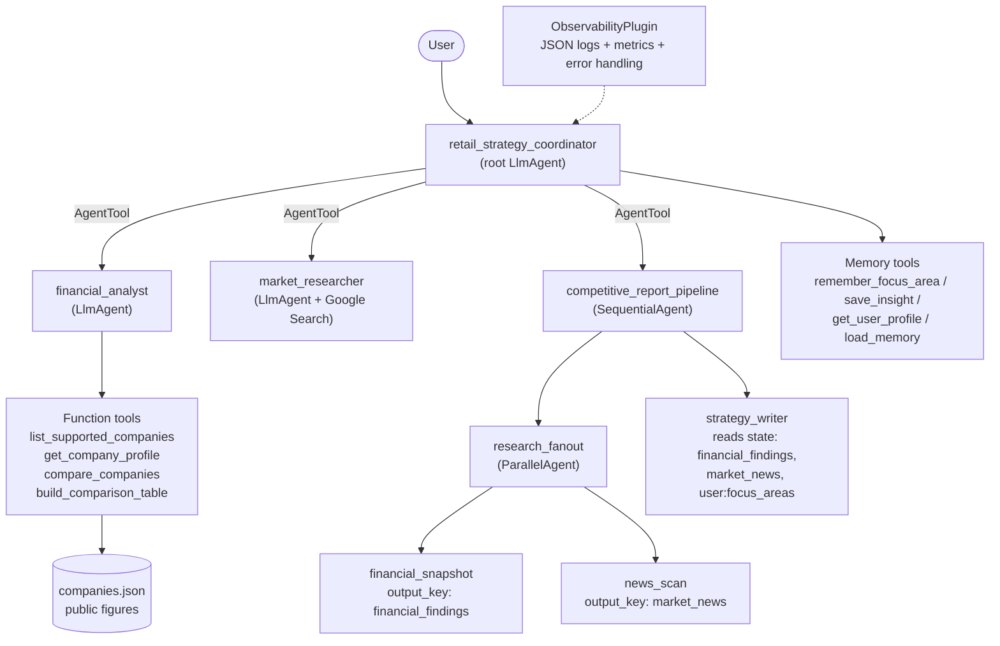

# 🛒 Retail Competitive Intelligence Agent

A multi-agent system built with the **Google Agent Development Kit (ADK)** that helps a
strategy team compare **Walmart** with its top five US retail competitors:
**Amazon, Costco, Target, Kroger and The Home Depot**. It uses **public data only**.

> **Track:** Enterprise Agents

---

## 1. The problem

Before account strategy planning, teams spend hours collecting competitor financials,
reading earnings news and building SWOT slides by hand. The information is scattered across
10-Ks, press releases and news sites, and it goes stale quickly.

## 2. The solution

You ask a question in plain English, for example:

> *"Compare Walmart vs. Costco and Target on membership and e-commerce, and give me talking points."*

A team of specialist agents then:

1. pulls **structured financials** from a curated public dataset, using tools that rank,
   compare and calculate ratios,
2. **searches the web** for the latest strategic moves,
3. writes an **executive brief** with a scorecard, a competitor-by-competitor view, a SWOT
   and talking points,
4. **remembers** your focus areas (for example *retail media* or *grocery*) and saved
   insights, so later answers are tailored to you.

---

## 3. Architecture



| Rubric area | How this project addresses it | Where |
|---|---|---|
| **Tool & Interface Design** | 7 typed function tools with detailed docstrings, input validation, alias resolution, and a consistent `{"status": "success" \| "error"}` contract so the agent can recover. Built-in `google_search`. Specialist agents exposed as `AgentTool`s. | [`tools/retail_tools.py`](retail_intel_agent/tools/retail_tools.py) |
| **Context & Memory** | **Session state** (`last_compared_companies`), **user-scoped persistent state** (`user:focus_areas`, `user:saved_insights`) injected into prompts, **long-term memory** (`load_memory` plus automatic `add_session_to_memory` after each turn), **state hand-off** between pipeline steps via `output_key`, and **context compaction** (`EventsCompactionConfig`) for long sessions. | [`agent.py`](retail_intel_agent/agent.py) |
| **Orchestration & Logic** | Coordinator / specialist pattern. The LLM routes requests to the right tool, using a **SequentialAgent** wrapping a **ParallelAgent** fan-out followed by a writer. `before_agent` / `after_agent` / `before_model` callbacks. An **input guardrail** blocks confidential content. | [`agent.py`](retail_intel_agent/agent.py), [`prompts.py`](retail_intel_agent/prompts.py) |
| **Observability & Tracing** | Custom `ObservabilityPlugin` that writes structured JSON logs for every agent, model and tool step, records latency and token usage, aggregates per-run metrics, and handles tool errors gracefully. ADK's OpenTelemetry traces appear in the `adk web` **Trace** tab and can be exported to **Cloud Trace** (`--trace_to_cloud`). | [`observability.py`](retail_intel_agent/observability.py) |
| **Infrastructure & CI/CD** | GitHub Actions (ruff lint, pytest on Python 3.11 and 3.12, Docker build), `Dockerfile`, a one-command Cloud Run deploy with tracing, a `Makefile`, pinned dependencies, `.env.example`, and secrets kept out of git. | [`.github/workflows/ci.yml`](.github/workflows/ci.yml), [`Dockerfile`](Dockerfile), [`deployment/`](deployment/) |

---

## 4. Quick start

```bash
# 1. Install
git clone https://github.com/<your-username>/retail-competitive-intel-agent.git
cd retail-competitive-intel-agent
make install            # creates .venv and installs dependencies

# 2. Add your Gemini API key (free: https://aistudio.google.com/apikey)
cp .env.example retail_intel_agent/.env
# edit retail_intel_agent/.env and paste your key

# 3. Chat with the agent in your browser at http://localhost:8000
make web
```

### Try these prompts
- `Which companies can you analyze?`
- `Rank all six retailers by operating margin.`
- `I care most about retail media and grocery.` *(saved to memory)*
- `Give me a full competitive brief on Walmart vs. Amazon and Costco.`
- `What has Target announced recently about its loyalty program?`
- `Save this insight: Costco's renewal rate is the loyalty benchmark.`
- `What do you remember about me?`

### Run the tests
```bash
make test   # unit tests run offline; the live end-to-end test runs if GOOGLE_API_KEY is set
make lint
```

### Observability
- **Logs:** each step prints one JSON line, for example
  `{"message": "tool_completed", "tool": "compare_companies", "latency_ms": 2, ...}`, and each
  run ends with a `run_completed` summary of model calls, tool calls, tokens and latency.
- **Traces:** open the **Trace** tab in `adk web` to see the span tree for every agent, LLM
  call and tool call.
- **Cloud:** `make deploy` sends traces to Google Cloud Trace.

### Deploy to Cloud Run
```bash
export GOOGLE_CLOUD_PROJECT=your-project-id
make deploy
```

---

## 5. Project structure

```
retail-competitive-intel-agent/
├── retail_intel_agent/
│   ├── agent.py            # root agent, specialists, pipeline, callbacks, App
│   ├── prompts.py          # all agent instructions
│   ├── config.py           # env-driven settings (model, compaction)
│   ├── observability.py    # logging/metrics/error-handling plugin
│   ├── tools/retail_tools.py
│   └── data/companies.json # curated public figures
├── tests/                  # pytest suite (tools, wiring, guardrail, plugin, live e2e)
├── deployment/deploy_cloud_run.sh
├── .github/workflows/ci.yml
├── Dockerfile
├── Makefile
├── pyproject.toml / requirements.txt
└── .env.example
```

## 6. Data disclaimer

The figures in `companies.json` are **approximate, rounded values from public annual
reports**, included for illustration. Verify them against the latest filings before making
decisions. The agent is designed for public information only and includes a guardrail that
declines to process content marked as confidential.
